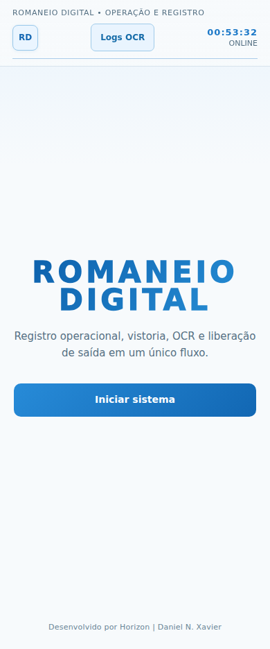
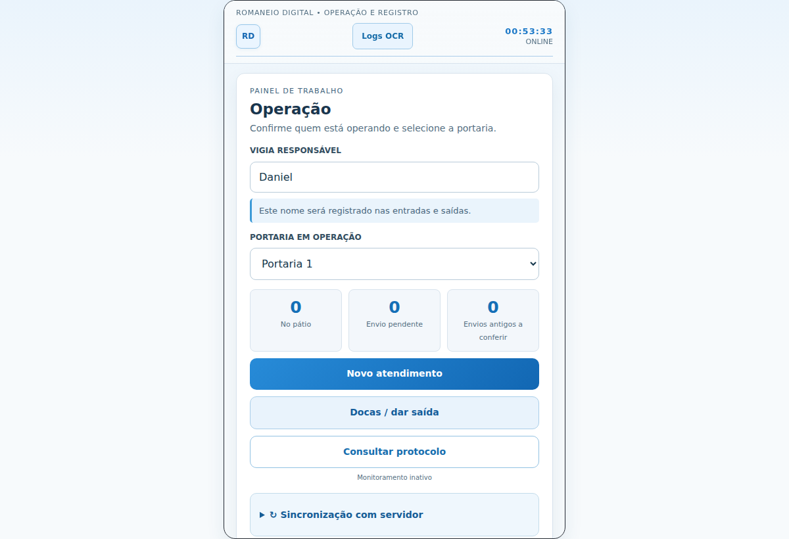
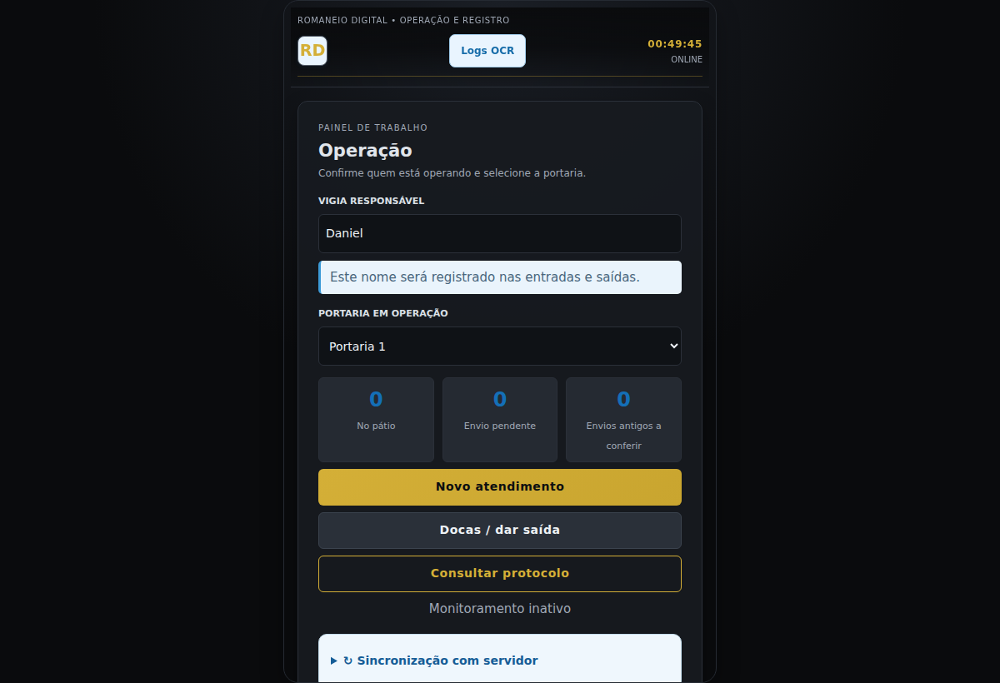

# Comparativo isolado de melhorias no Romaneio Digital

Base original: `main` em `1eb78ea`. Objetivo: comparar melhorias produzidas por dois modelos no mesmo código e nas mesmas condições, **sem substituir o fluxo operacional aprovado**.

## Estado real dos dois modelos (22/10/2026)

| Modelo | Provedor | Resultado | Evidência |
| --- | --- | --- | --- |
| GPT-OSS 120B | Groq, API configurada na VPS | Gerou CSS (7.237 tokens) e o revisou após QA de contraste (6.094 tokens adicionais). **Total medido: 13.331 tokens** | `css/ux-benchmark.css`, capturas e testes abaixo |
| Gemma 4 31B (`gemma-4-31b-it`) | Gemini API Google, chave atual da VPS | **Não gerou saída aproveitável**. Três tentativas deram timeout/HTTP 500; rota OpenAI-compatível também HTTP 500 | Resultado é falha de disponibilidade do endpoint neste ambiente, **não** pontuação de qualidade de código do Gemma |

A chamada para listar os modelos Google confirma `gemma-4-31b-it` e suporte a `generateContent`. Isso não comprova inferência disponível neste projeto. Para avaliação válida entre modelos, usar outro provedor hospedado **com autenticação autorizada**, manter o mesmo código base e repetir os testes.

## Alterações do candidato GPT-OSS

- Apenas `css/ux-benchmark.css` e inclusão explícita da folha em `index.html`. Nenhuma modificação em `js/app.js`, OCR, servidor, banco de dados ou regras de negócios.
- Evolução visual preto/dourado: cores de texto corrigidas, botões, espaços, foco e tamanhos de toque. É um **candidato de UI**, não uma reconstrução funcional do sistema.
- Fluxos preservados: abertura → onboarding → operação; telas e lógica de triagem, foto/OCR, vistoria, cancelamento, docas, protocolo e sincronização continuam provenientes da base.
- **22/22 testes automatizados passaram**. Playwright percorreu os 3 passos do onboarding até Operação em viewport 390×844, sem erros JS. Capturas 390×844 e 1200×800; o teste não constitui validação completa de todos os fluxos num Android físico.

## Capturas reais: antes e depois

| Tela | Original (`main`) | Candidato GPT-OSS |
| --- | --- | --- |
| Boas-vindas mobile |  |  |
| Operação mobile |  |  |
| Operação desktop |  |  |

Os caminhos das imagens acima são relativos à pasta `benchmarks/` deste documento.

## Critério justo de eficiência

A comparação só considera uma tarefa como entregue depois de passar pelos critérios técnicos e receber validação. Reprovação e retrabalho contam no total consumido. Tokens baixos sem correção e estabilidade não demonstram eficiência.

**Segurança de implantação:** manter esta branch e sua PR separadas de `main` até a comparação com Gemma e a escolha do proprietário. Os dados e fluxos de produção ficam intactos.
